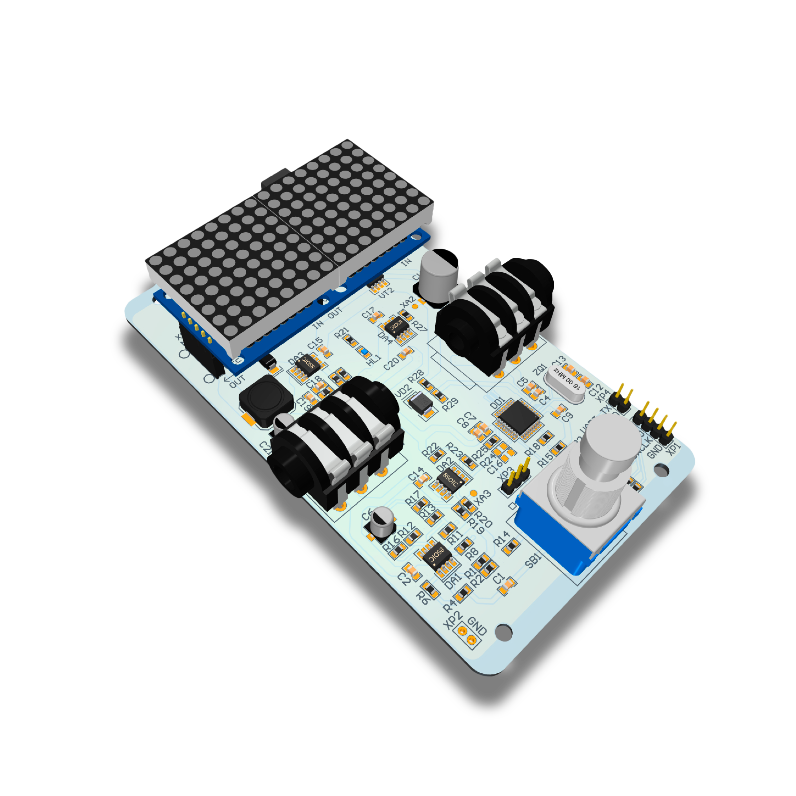
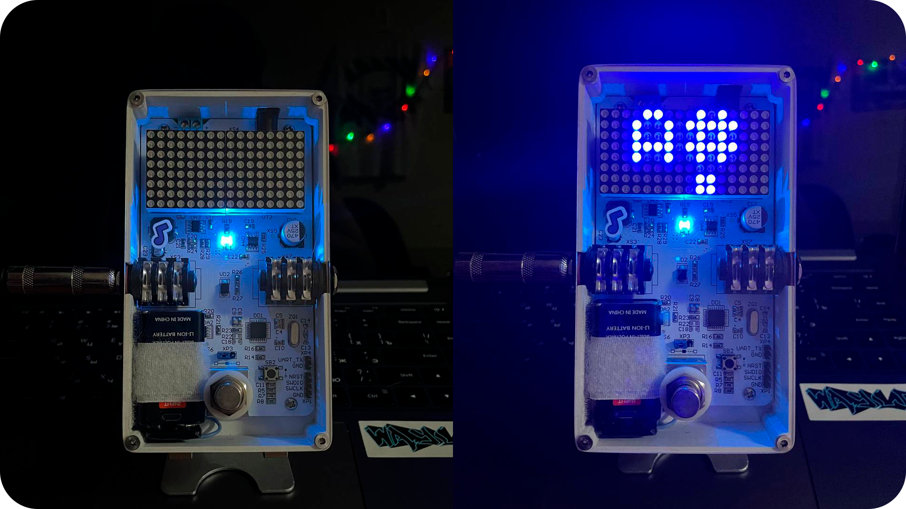
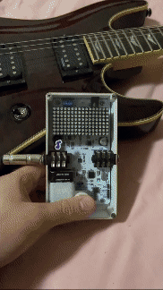
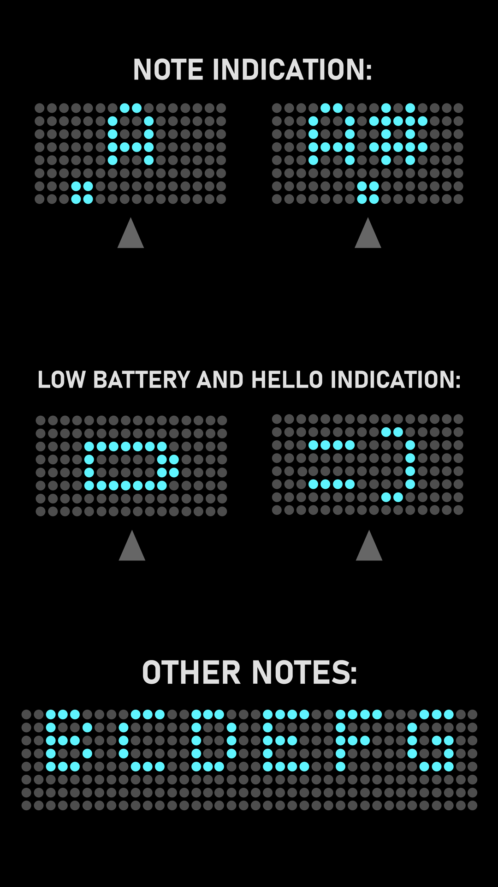

<h1 align="center">STM32 Guitar Tuner</h1>

<p align="center">
  A guitar tuner built from the circuit board to the firmware and enclosure.
  <br>
  Developed as my bachelor's project.
</p>

<p align="center">
  <strong>STM32F042</strong> · <strong>Cortex-M0</strong> · <strong>C / CMSIS / LL</strong> · <strong>LED matrix</strong>
</p>

<p align="center">
  
</p>

<p align="center">
  <a href="#demo">Demo</a> ·
  <a href="#features">Features</a> ·
  <a href="#how-it-works">How it works</a> ·
  <a href="#hardware">Hardware</a> ·
  <a href="#build-and-flash">Build &amp; flash</a>
</p>

## Demo

The assembled tuner in its enclosure, followed by a demonstration of the tuning display.

<p align="center">
  
</p>

<p align="center">
  
</p>

## Features

- **Chromatic note detection** — displays natural notes and sharps, covering all 12 pitch classes.
- **Visual tuning feedback** — shows the detected note above a moving tuning indicator on a 16 × 8 LED display.
- **Reading averaging** — combines 12 measurements assigned to the same note before updating the display.
- **Battery monitoring** — shows a low-battery warning at startup; a critical battery level triggers a warning and stops firmware execution.
- **Startup animation** — greets the player with a short smile and wink sequence.
- **Custom hardware** — circuit and PCB design, embedded firmware, and enclosure development in one project.

## How it works

```text
Input signal → TIM1 input capture → Period-to-frequency conversion
                                          ↓
LED matrix ← Note + tuning position ← Note lookup and averaging

Battery voltage → ADC → Battery status / warning screens
```

1. **Measure the period.** TIM1 captures incoming edges on PA8. With the timer running at 1 MHz, the captured interval is expressed in microseconds.
2. **Identify the note.** The firmware converts the period into frequency, folds higher octaves into a reference octave, and compares the result with a table of note boundaries.
3. **Stabilize the reading.** It averages 12 frequency readings assigned to the same note and calculates the tuning indicator position.
4. **Update the display.** The note glyph and indicator are sent over SPI to the LED display. The display clears after about one second without a new note update.

The main loop services the display, note calculation, and battery checks. Timer interrupts supply period measurements; the firmware runs without an RTOS.

See [`notes.c`](stm32_project/Core/Src/tuner_components/notes.c) for note detection and [`stm_timers.c`](stm32_project/Core/Src/hardware/stm_timers.c) for input capture.

## Hardware

| Component | Implementation |
| :--- | :--- |
| Microcontroller | STM32F042K6T7, Arm Cortex-M0 |
| System clock | 48 MHz |
| Pitch measurement | TIM1 input capture on PA8 |
| Display | Two 8 × 8 LED matrices, controlled over SPI |
| Battery sensing | ADC with periodic voltage checks |
| Firmware | C, CMSIS and STM32 LL drivers |
| Build tools | GNU Arm toolchain and Make |
| Programming / debugging | OpenOCD over SWD; ST-Link and J-Link configurations included |
| Electronics design | Altium Designer 18 |

### Circuit schematic

- [Circuit schematic (PDF)](schematic/shematic.pdf)

### Display guide

The letter identifies the detected note, `#` marks a sharp, and the lower indicator shows the tuning position. The display also includes battery and startup symbols.

<p align="center">
  
</p>

## Build and flash

### Prerequisites

- GNU Arm toolchain: `arm-none-eabi-gcc`, `arm-none-eabi-objcopy`, and `arm-none-eabi-size` available on `PATH`.
- Make.
- OpenOCD and a compatible SWD probe for programming the board.
- For the editor workflow: Visual Studio Code with the **Cortex-Debug** extension and `arm-none-eabi-gdb`.
- For the supplied VS Code tasks: Bash and `readlink -f`. Windows settings select Git Bash; on macOS, check that the installed `readlink` supports `-f`.

### Build from a terminal

From the repository root:

```sh
cd stm32_project
make build -j4 output_path=Output/App cmakelist=Scripts/build/app_sources.mk
```

The build produces these files in `stm32_project/Output/App/`:

| File | Purpose |
| :--- | :--- |
| `STM32-guitar-tuner.elf` | Firmware with debug symbols |
| `STM32-guitar-tuner.hex` | Firmware in Intel HEX format |
| `STM32-guitar-tuner.bin` | Raw firmware image |

If the compiler is outside `PATH`, pass `GCC_PATH=/path/to/toolchain/bin` to Make.

### Flash with ST-Link

Connect the probe to the board's SWD signals and ground. After building, run this command from `stm32_project/` to program and verify the firmware, then reset the MCU:

```sh
openocd -f interface/stlink.cfg -f target/stm32f0x.cfg \
  -c "program Output/App/STM32-guitar-tuner.hex verify reset exit"
```

### Build and debug in VS Code

1. Open **`stm32_project/`** as the workspace folder so VS Code loads the supplied `.vscode` configuration.
2. Check tool paths and probe settings in [`.vscode/settings.json`](stm32_project/.vscode/settings.json).
3. Open **Terminal → Run Build Task** with <kbd>Ctrl</kbd> + <kbd>Shift</kbd> + <kbd>B</kbd> on Windows/Linux or <kbd>Cmd</kbd> + <kbd>Shift</kbd> + <kbd>B</kbd> on macOS, then select **🛠 Build App**.
4. To program using ST-Link, select **📘 🔵 ST App erase + flash** from the task menu. This task builds the firmware, erases the target flash, and writes the new image.
5. For debugging, select an ST-Link or J-Link launch configuration in **Run and Debug**.

The VS Code build task also copies `.hex` and `.bin` files to `Output/Artifacts/`. Debug configurations use the `.elf` file in `Output/App/`.

## Repository layout

```text
.
├── .github/assets/            # Board render, device photo, demo GIF and display guide
├── schematic/                 # Circuit schematic (PDF)
└── stm32_project/
    ├── .vscode/               # Build tasks and debugger configuration
    ├── Core/
    │   ├── Inc/               # Application headers
    │   └── Src/
    │       ├── main.c         # Startup and main loop
    │       ├── hardware/      # ADC, SPI and timer setup
    │       ├── tuner_components/
    │       │                  # Note detection, display, battery and screens
    │       └── utils/         # Timing helpers
    ├── Drivers/               # CMSIS and STM32 drivers
    ├── OCD/                   # OpenOCD configuration and device description
    ├── Scripts/               # Build and debug helpers
    └── Makefile
```
